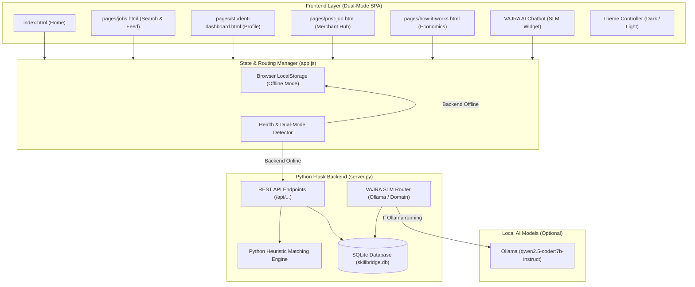

# SkillBridge AI — System Architecture & Data Flow

## Key Architectural Principles
1. **Zero-Failure Pitch:** If the Python server or internet fails, the application automatically degrades to in-browser `localStorage`.
2. **Deterministic Matching Formula:**
   $$\text{Score} = (\text{Skill Overlap Ratio} \times 60) + (\text{Budget Fit} \times 25) + (\text{Availability} \times 15)$$
3. **Multi-Page Separation:** Clear separation of concerns between Home, Discovery, Student Hub, Merchant Hub, and Economics.
